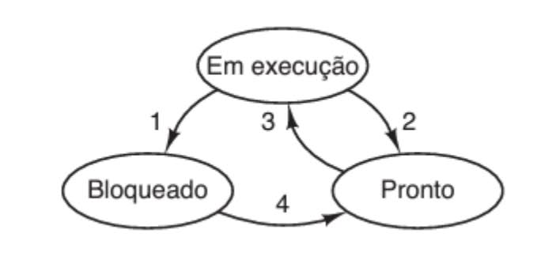

---

marp: true
theme: default
paginate: true
size: 16:9
color: black

---

# Gerenciamento de Processos
### CARIFR1

---

# O que é um processo?
Um *processo* é um **programa** em execução, acompanhado dos recursos e das informações necessários à sua execução.

---

# Informações de um processo
- Identificador do processo (PID)
- Estado de execução
- Prioridade
- Recursos utilizados

---

# Escalonamento de processos
1. Identifica os processos prontos
2. Seleciona um processo conforme a política de escalonamento
3. Disponibiliza a CPU ao processo selecionado

---

# Comandos do Windows
- O Windows possui um conjunto de comandos de console integrados
- A documentação descreve os [Comandos do Windows](https://learn.microsoft.com/pt-br/windows-server/administration/windows-commands/windows-commands) que podem ser usados para automatizar tarefas

---

# Estados de um processo
Um processo pode mudar de estado conforme a disponibilidade da CPU e a ocorrência de eventos

---

# Processos no terminal
|**COMANDO**|**FUNÇÃO**|**EXEMPLO**|
|---|---|---|
|**tasklist**|*Listar os processos em execução*|tasklist|
|**tasklist /v**|*Exibir informações detalhadas dos processos*|tasklist /v|
|**tasklist /fi**|*Filtrar processos por um critério*|tasklist /fi "imagename eq chrome.exe"|
|**tasklist /svc**|*Mostrar serviços associados aos processos*|tasklist /svc|
|**start**|*Iniciar um programa*|start notepad|
|**where**|*Localizar o executável de um comando*|where notepad|
|**systeminfo**|*Consultar informações do sistema*|systeminfo|

---

# tasklist

---

# tasklist /V

---

# tasklist /fi

---

# tasklist /svc

---

# start

---

# where
